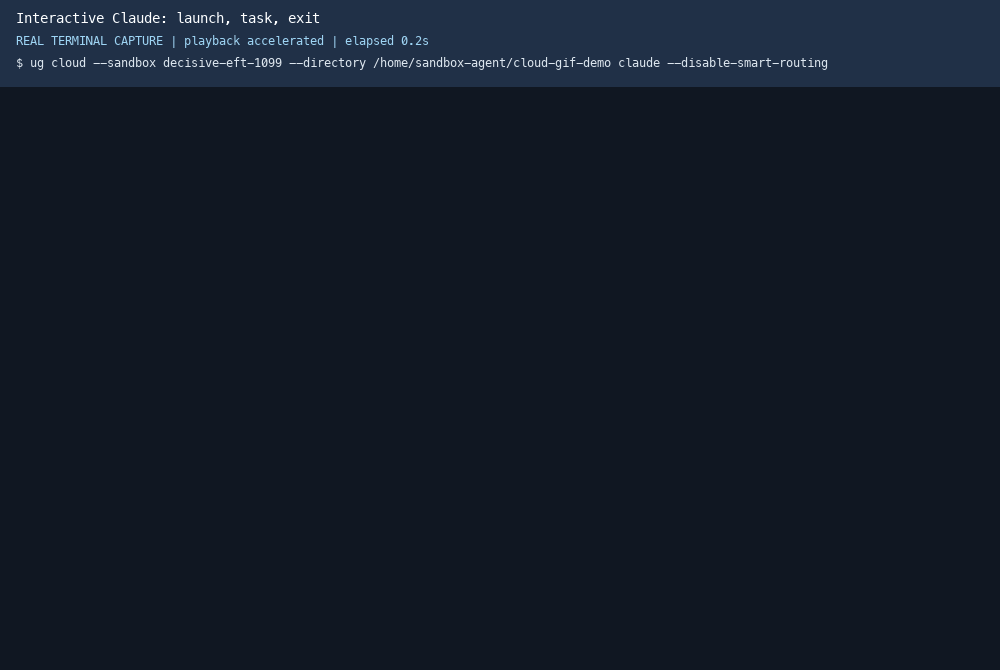
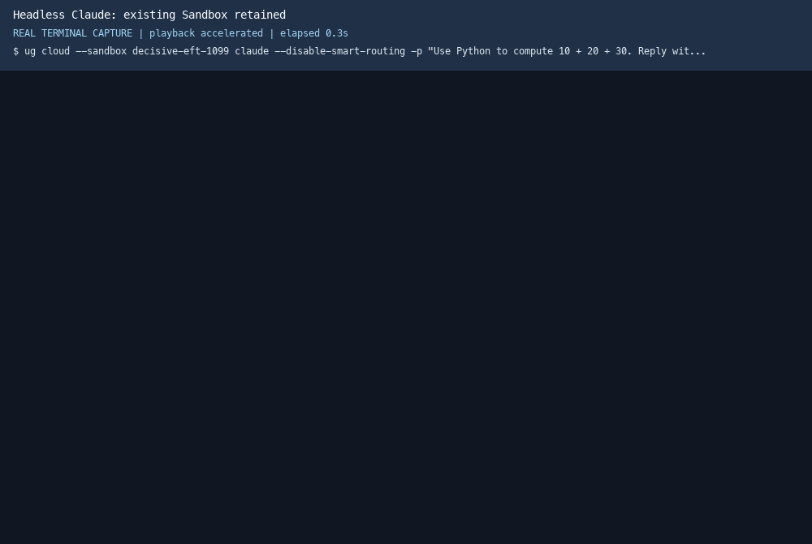
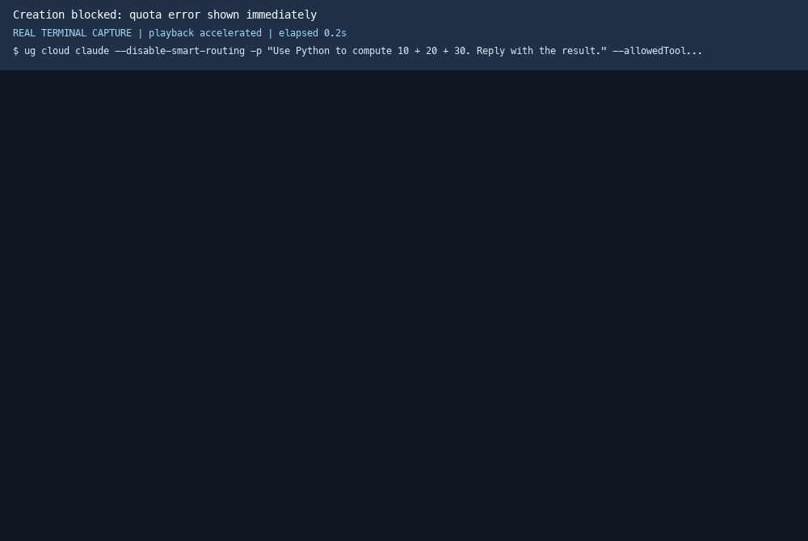

# Cloud CLI recordings

Recaptured November 15, 2026 on Ubuntu with candidate `0.2.1+cloudpr.1`.
These GIFs show real terminal output with accelerated playback and elapsed-time labels.
The candidate is on `PATH`; the workspace is already configured. Commands use the
remote directory default. `claude` is required: `ug cloud` alone displays help.

## Open Claude

`ug cloud --sandbox decisive-eft-1099 claude`

Reuse an existing Sandbox. Ask Claude to remember `amber-29`. The default router
selects a deprecated DeepSeek endpoint and the request fails. Enter `/model opus`
inside Claude and repeat the prompt: Claude replies `SAVED`. Exit retains the Sandbox.

## Resume Claude

`ug cloud claude`

Choose “Resume previous session”. Ask Claude for the marker: it recalls `amber-29`.
Exit retains the Sandbox. No workspace, directory, or session ID is needed on the command line.

## Run a headless prompt in an existing Sandbox

`ug cloud --sandbox decisive-eft-1099 claude -p "What is 10 + 20 + 30?"`

The command reaches Claude, but the default router selects
`system.ai.deepseek-v4-1-flash`. Gateway returns `400 BAD_REQUEST` because the
endpoint is deprecated; the job exits 1. The explicitly reused Sandbox is retained.
This minimal-command recording does **not** show a successful model response.
The earlier successful headless recording disabled smart routing; this one leaves defaults intact.

## Run a headless prompt in a new Sandbox

`ug cloud claude -p "What is 10 + 20 + 30?"`

Creation is rejected at the service quota of **200**. ug reports the error and exits 1
in about **3 seconds**. No Sandbox is created; automatic cleanup remains unverified live.

`--sandbox` appears only when explicitly reusing an environment; `-p` selects headless mode.
The longer recovery commands printed by ug itself remain visible as actual CLI output.
