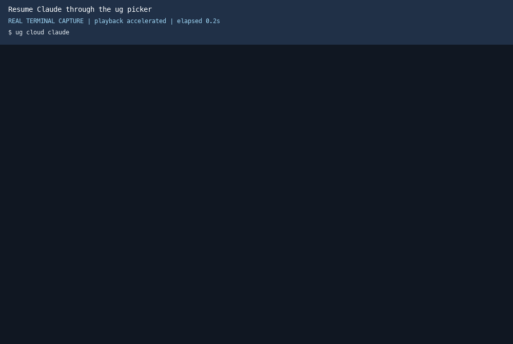

# Cloud CLI recordings

Captured November 15, 2026 on the Ubuntu VM with installed candidate `0.2.1+cloudpr.1`.
These GIFs render real SSH terminal output; playback is accelerated and the header shows
actual elapsed time. They are text-based terminal recordings, not reconstructed mockups.
The workspace's native agent policy and existing warnings remain visible.

## Interactive Claude: launch, task, exit

Open Claude in the existing Sandbox, accept trust for the dedicated demo directory,
ask it to remember `amber-29`, receive `SAVED`, then exit. The footer prints the resume command.

## Resume through the picker

Choose “Resume previous session” and ask for the marker without repeating it.
Claude returns `amber-29` from the same conversation; exit succeeds.

## Headless execution in an existing Sandbox

Claude runs the calculation and returns **60**, exit 0. This uses `--sandbox`, so the
existing environment is retained. This recording does **not** demonstrate automatic deletion.

## Fresh creation: quota rejection

The service rejects creation at the configured limit of **200**. ug surfaces that error
and stops in approximately **2.2 seconds**, exit 1. No new Sandbox is created.
A fresh-job-plus-automatic-cleanup recording remains blocked by this quota.

