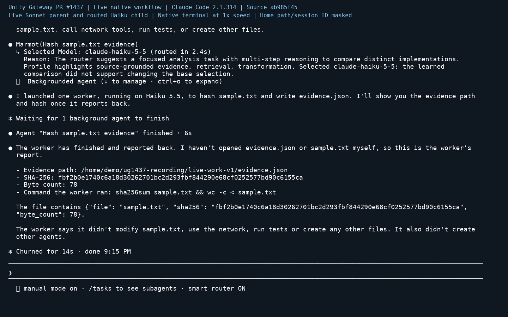

# Live routing feedback and delegation

[Watch the live recording](live-recording.mp4) (44.2 seconds).

The first live run uses native Claude Code 2.1.314 with a Sonnet 5.5 parent and a
routed Haiku 5.5 child. It was recorded at `ea7141fc`; product source is unchanged
from `ab985f45`. Model responses and the routing decision came from the live gateway.

- 0:00: Supply the disable reason once. The first off command reuses it verbatim,
  and the session then turns routing back on.
- 0:18: Delegate a file check. The child runs `sha256sum` and `wc`, writes
  `evidence.json`, and returns the matching 78-byte file's hash through the parent.
- 0:38: Read the actual session's routing log through the native CLI. It retains
  a 160-character prefix plus an ellipsis from the 638-character assignment.

The run also shows limits: `/isaac-feedback` is unavailable, so feedback is not
submitted. The parent explains the assignment after spawning and returns a file
path; a pre-spawn explanation and clickable evidence link are not observed. The
changed Codex legacy notice and encrypted-assignment omission are not exercised
by this Claude session. This run does not establish general instruction-following,
billing behavior or other-provider compatibility.

The native log preview above is distinct from the Codex legacy notice covered by
the historical component checks. The supplied `sample.txt` is ordinary demo input;
no model responses, routing choices or failures are simulated. The private model
picker uses four already-discovered family defaults within the router's 20-choice
limit. Existing authentication and corporate policy are retained.

The video renders observed terminal cells at their original timestamps. Only
onboarding and exit are trimmed; the home path and session ID are masked. Raw
session/request records and usage remain private. [Hashes and provenance](live-provenance.json).

The [earlier fixture recording](recording.mp4) and its
[original documentation](https://github.com/databricks/unity-gateway/blob/ea7141fc5b83473d37d5e1a09cce34202cceb663/docs/demos/pr-1437/README.md)
are retained as historical evidence. They do not satisfy the live E2E requirement.
