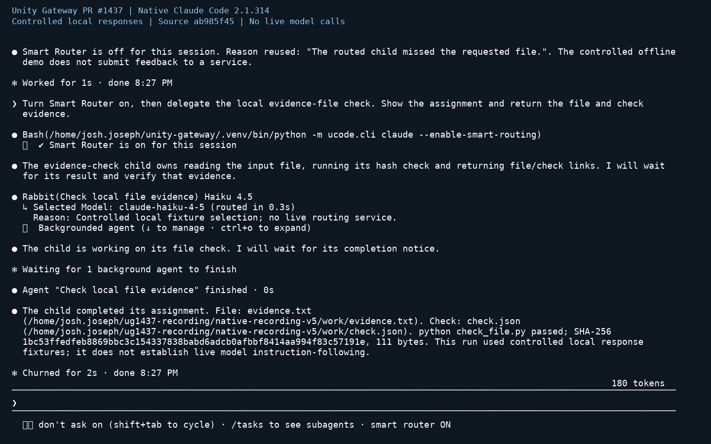

# Routing feedback and delegation

[Watch the recording](recording.mp4) (45.7 seconds, 861,236 bytes).

Recorded from source `ab985f45bb371eceeb12bc035708e561bdb9d3cf`, using Unity Gateway
`0.0.0+1.gab985f4`, Python 3.12.3 and native Claude Code 2.1.314.

- 0:00: The user supplies "The routed child missed the requested file." once.
  The native session reuses it in the actual UG disable command, enables routing
  again, delegates a file check and returns the child's file and command evidence.
- 0:21: The actual Codex routing-hook CLI shows a 231-character preview for a
  1,137-character plaintext assignment. It omits the encrypted preview and uses
  the task name for routing. Both original child assignments remain unchanged.

Model responses and routing selections are controlled local fixtures. Native tool
execution, session controls, the child's file check and CLI notices are real.
The video renders recorded terminal cells at their original timestamps. This run
does not establish general model instruction-following, provider compatibility,
live feedback submission or billing behavior.

The child's 111-byte input file has SHA-256
`1bc53ffedfeb8869bbc3c154337838babd6adcb0afbbf8414aa994f83c57191e`.
Video SHA-256:
`d8aba9ac5b235768ec7ed7f995708bbf08328f8a224aa507198385c7e3c7fe48`.

