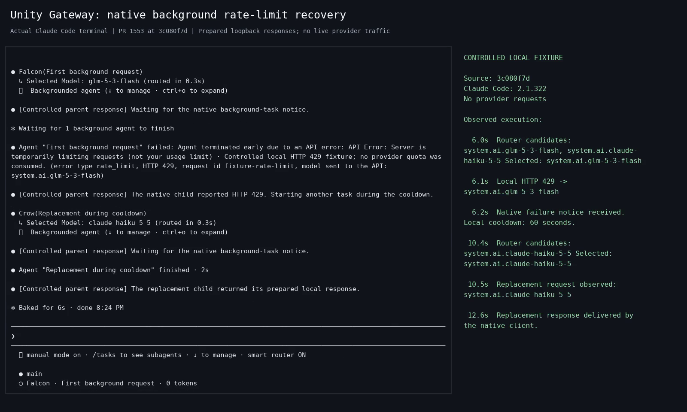

# Background rate-limit recovery

[Watch the terminal recording](native-cooldown.mp4) (16 seconds).

Claude Code 2.1.322 runs the unchanged Unity Gateway source at
`3c080f7db0e7beb0d3285b57ed52360d018724d9`. Its background child receives HTTP 429,
and the native client emits a failure notice. The next routing request starts
4.05 seconds later, during the 60-second cooldown. It excludes `glm-5-3-flash`
and offers only `system.ai.claude-haiku-5-5`; that replacement child completes.

All model text and router decisions come from controlled local HTTP fixtures in
a loopback-only network namespace. Native retries are set to zero for this brief
recording. The video renders actual PTY output in real time; its sidebar records
events from the same execution. It demonstrates the native notification and
routing flow, with no claim about live instruction following, provider
compatibility, quota recovery or billing.

[Provenance and media hashes](provenance.json) include the source and runtime
versions, controlled inputs and observed model selection. Raw transcripts and
local profiles are excluded from these assets.
