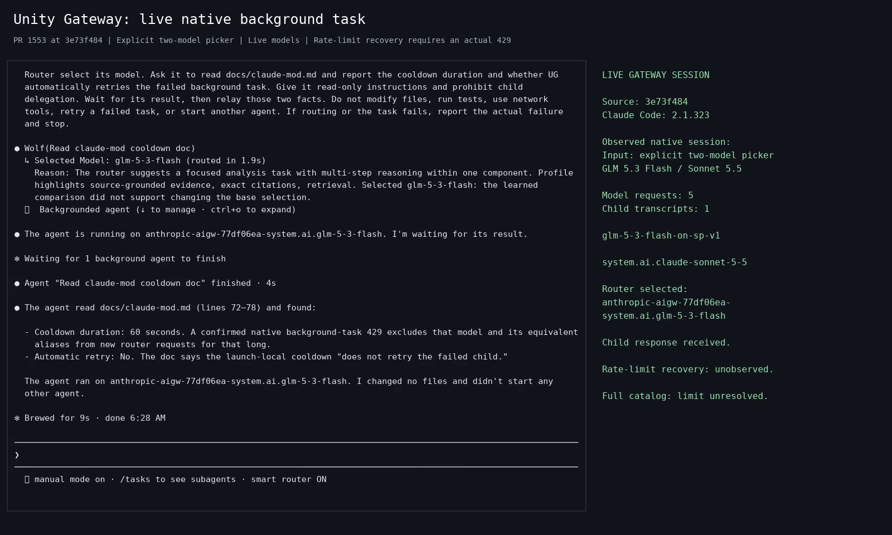

# Live routed background task

[Watch the recording](native-background-task.mp4) (17 seconds).

Claude Code 2.1.323 runs Unity Gateway at
`3e73f484feda1fd575f694cf0a7b4860b418a50e`, whose product code is unchanged from
`3c080f7db0e7beb0d3285b57ed52360d018724d9`. The Sonnet 5.5 parent delegates a
document read to a fresh background child. The live router selects GLM 5.3 Flash;
both child requests use that selection. The child reads `docs/claude-mod.md`,
completes, and the parent reports its result. The session made five native model
requests and one successful route-selection request, with automatic retries off.

This scenario explicitly offers GLM 5.3 Flash followed by Sonnet 5.5 in a private
model picker. The original 31-option/29-service menu still exceeds the route API
limit of 20 distinct model services. This recording does not repair that mismatch.
No HTTP 429 occurred, so cooldown exclusion and replacement selection remain
unverified. The child's answer describes the documented behavior; it does not
exercise recovery. Live cooldown acceptance remains pending.

The video renders actual native terminal output in real time. Only the startup
workspace address is masked; task output and timing are preserved.
The [PR description](https://github.com/databricks/unity-gateway/pull/1553) records
the exact source, runtime, ordered model choices, observations and media hashes. The [earlier live session](../live/README.md)
and [fixture recording](../README.md#historical-fixture-recording) remain preserved.
