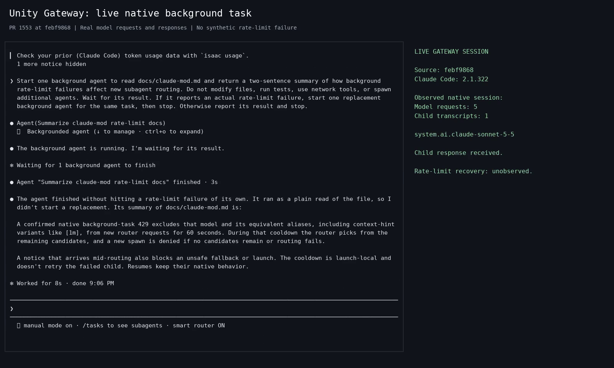

# Live background task

[Watch the recording](native-background-task.mp4) (16 seconds).

Claude Code 2.1.322 runs Unity Gateway at
`febf9868d485e4a6a41692f763d4eac847d5ef9e`, whose product code is unchanged from
`3c080f7db0e7beb0d3285b57ed52360d018724d9`. The parent starts a background child
to read `docs/claude-mod.md`, receives its completion and reports the result.
The session made five native model requests through the live gateway; both
parent and child responses identify `system.ai.claude-sonnet-5-5`.

The routing command ran from this checkout but returned no selection output.
The child used the same model as its parent; this recording does not establish
successful router selection. No HTTP 429 occurred, so cooldown exclusion and
replacement selection remain unobserved. The model's description of cooldown
behavior is a summary of the source documentation, not an execution of that path.
Live cooldown acceptance remains pending.

The video renders actual native terminal output in real time. Model responses
are live, native retries retain their defaults, and no failure was injected.
[Provenance and media hashes](provenance.json) record the inputs and observations.
The [earlier fixture recording](../README.md) remains historical evidence and
does not satisfy the live E2E requirement.
